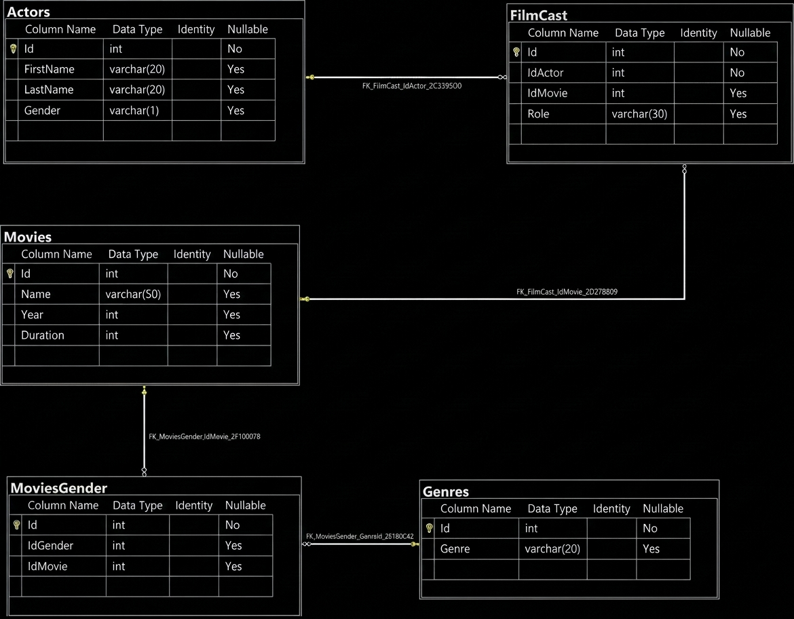
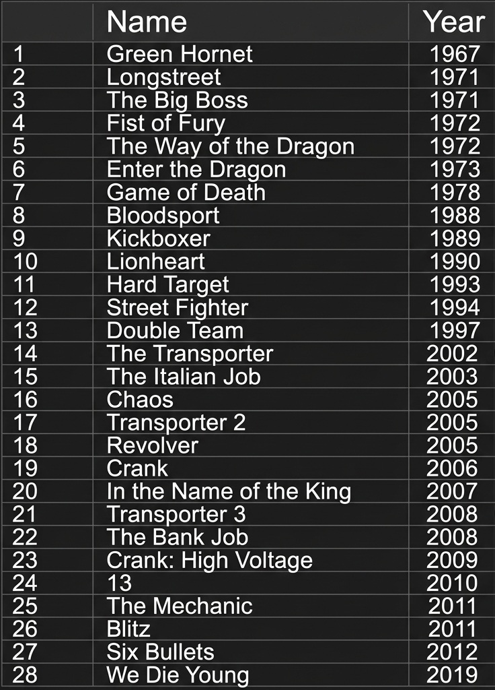
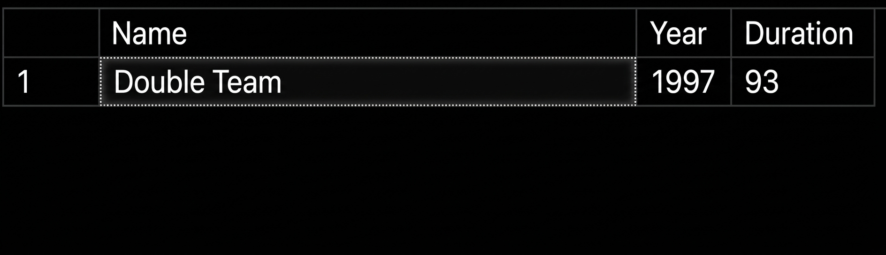
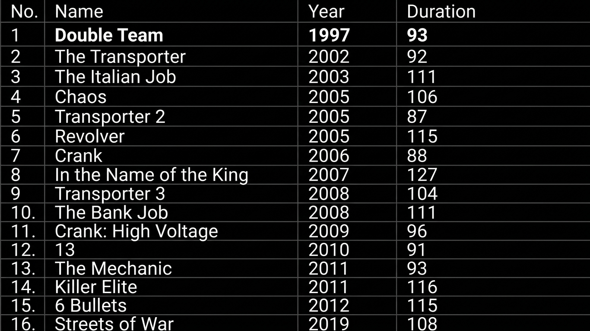
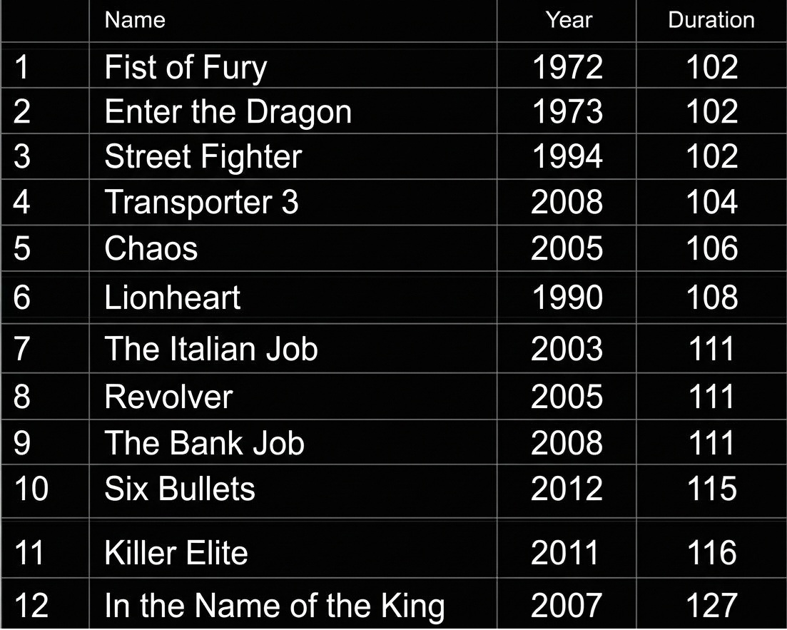
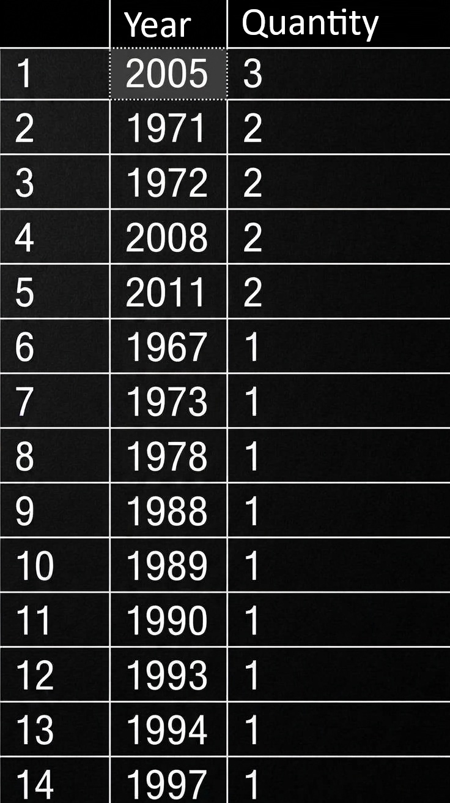
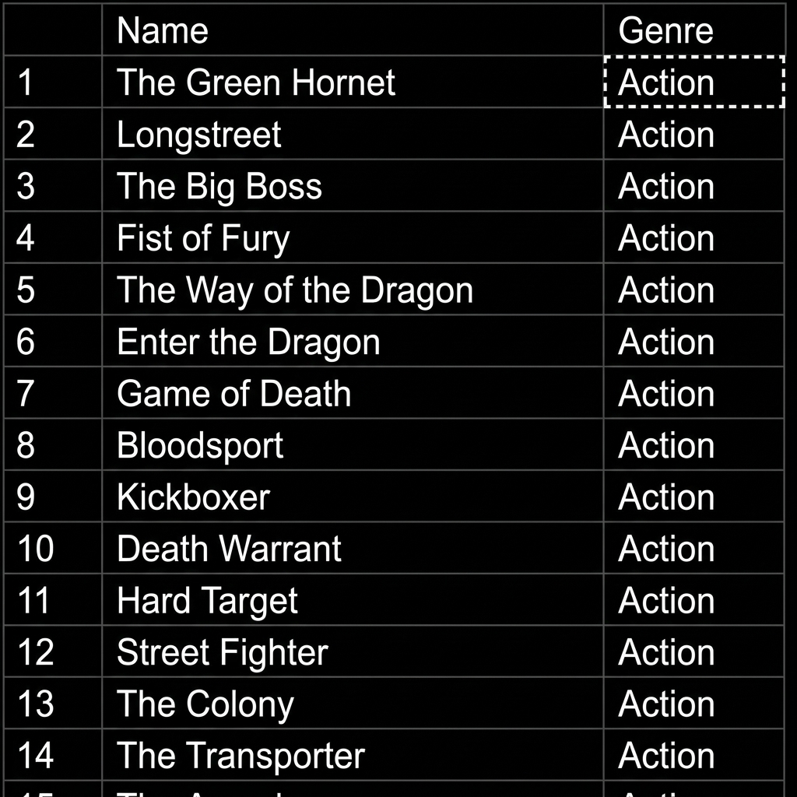
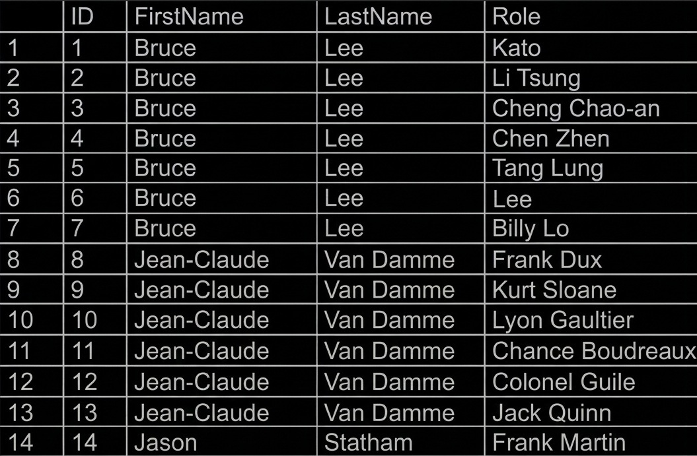

# Building Relational Queries in SQL Server

Project developed at the WEX Bootcamp - .NET Development and QA, under the guidance of specialist [Leonardo Buta](https://github.com/leonardo-buta/ "Leonardo Buta").

## Project Challenge

For this project challenge, you are asked to perform a database query to retrieve specific data for analysis. Apply the knowledge you gained during the database module of the .NET track to implement the challenge as outlined by the expert.

## Context

You are responsible for the database of a movie website, which stores information about films and their actors. Consequently, you have been asked to perform a database query to retrieve specific data for analysis.

## Proposal

You will need to perform 12 database queries, each returning a specific type of information.
Your database is modeled as follows:



The tables are described as follows:

- **Movies**

Table responsible for storing information about movies.

- **Actors**

Table responsible for storing information about actors.

- **Genres**

Table responsible for storing movie genres.

- **MovieCast**

A table responsible for representing a many-to-many relationship between movies and actors-meaning an actor can work on many movies, and movies can feature many actors.

- **MoviesGender**

A table responsible for representing a many-to-many relationship between movies and genres-meaning a movie can have more than one genre, and a genre can be associated with many movies.

## Preparing the database

You will need to execute the **Script Movies.sql** file-found in the "Scripts" folder of this repository ([or click here](Script%20Movies.sql)) - in your SQL Server database. This script will create a database named **Movies**, containing the tables and data required for you to complete this challenge.

## Objective

You are to create several queries designed to return the data specified below. Each request is followed by the expected output. Your output must match what is shown in the image.

## 1 - Retrieve the names and release years of the films

```bash
SELECT Name, Year FROM Movies;
```



## 2 - Retrieve the names and release years of the films, sorted in ascending order by year

```bash
SELECT Name, Year 
FROM Movies 
ORDER BY Year ASC;
```


## 3 - Retrieve the film "Double Team," including its name, release year, and duration

```bash
SELECT Name, Year, Duration 
FROM Movies 
WHERE Name = 'Double Team';
```


## 4 - Retrieve the films released in 1997

```bash
SELECT Name, Year, Duration 
FROM Movies 
WHERE Year = 1997;
```



## 5 - Retrieve the films released AFTER the year 1996

```bash
SELECT Name, Year, Duration 
FROM Movies 
WHERE Year > 1996;
```



## 6 - Retrieve the films with a duration greater than 100 and less than 150, sorted by duration in ascending order

```bash
SELECT Name, Year, Duration 
FROM Movies 
WHERE Duration > 100 AND Duration < 150 
ORDER BY Duration ASC;
```



## 7 - Retrieve the number of films released per year, grouped by year, and sorted by duration in descending order

```bash
SELECT 
    [Year] AS Year, 
    COUNT(*) AS Quantity
FROM 
    [dbo].[Movies]
GROUP BY 
    [Year]
ORDER BY 
    Quantity DESC;
```



## 8 - Retrieve the male actors, returning their first and last names

```bash
SELECT 
    [FirstName], 
    [LastName]
FROM 
    [dbo].[Actors]
WHERE 
    [Gender] = 'M';
```


## 9 - Retrieve the male actors, returning their first and last names, sorted by first name

```bash
SELECT 
    [FirstName], 
    [LastName]
FROM 
    [dbo].[Actors]
WHERE 
    [Gender] = 'M'
ORDER BY 
    [FirstName] ASC;
```


## 10 - Retrieve the film names and their genres

```bash
SELECT 
    m.[Name] AS MovieName,
    g.[Gender] AS Genre
FROM 
    [dbo].[Movies] m
INNER JOIN 
    [dbo].[MoviesGender] mg ON m.[Id] = mg.[IdMovie]
INNER JOIN 
    [dbo].[Genders] g ON mg.[IdGender] = g.[Id];
```


## 11 - Retrieve the film names and their genres, specifically for the "Action" genre

```bash
SELECT 
    m.[Name] AS MovieName,
    g.[Gender] AS Genre
FROM 
    [dbo].[Movies] m
INNER JOIN 
    [dbo].[MoviesGender] mg ON m.[Id] = mg.[IdMovie]
INNER JOIN 
    [dbo].[Genders] g ON mg.[IdGender] = g.[Id]
WHERE 
    g.[Gender] = 'Action';
```



## 12 - Retrieve the film names and the actors involved, including their first names, last names, and roles

```bash
SELECT 
    m.[Name] AS MovieName,
    a.[FirstName] AS FirstName,
    a.[LastName] AS LastName,
    fc.[Role] AS [Role]
FROM 
    [dbo].[Movies] m
INNER JOIN 
    [dbo].[FilmCast] fc ON m.[Id] = fc.[IdMovie]
INNER JOIN 
    [dbo].[Actors] a ON fc.[IdActor] = a.[Id];
```



See [original repository](https://github.com/digitalinnovationone/trilha-net-banco-de-dados-desafio).

[LICENSE](/LICENSE)
