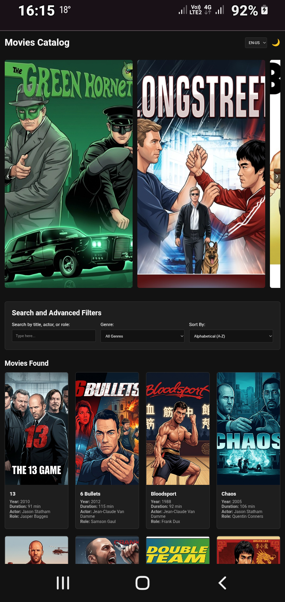

# Relational Database & Front-End Movie Explorer

This hybrid repository showcases advanced SQL Server database management paired with a robust, client-side catalog interface built using HTML5, CSS3, and JavaScript.

## Tech Stack

- **Database Management:** SQL Server (T-SQL)
- **Front-End Core:** Semantic HTML5, Native CSS3 (Flexbox/Grid variables), Vanilla JavaScript (ES6+)
- **Design Paradigm:** Mobile-First Responsive Web Design, Web Accessibility (ARIA guidelines), Internationalization

## Architectural Features

### 1. Relational Database Design

The schema features data persistence normalization covering:

- `Movies`: Base table mapping unique properties like names, years, and durations.
- `Actors` & `Genders`: Data structures handling actor taxonomy.
- `FilmCast` & `MoviesGender`: Pivot tables resolving strict many-to-many associations.

### 2. Client-Side Catalog Interface

- **Responsive Image Carousel:** Dynamic layout accommodating up to 28 movie posters mapped across `docs/assets/{id}.png`.
- **Advanced Filtering Mechanism:** Live in-memory client queries scanning titles, casts, roles, release ranges, and durations with multiple index sorting permutations.
- **Persistent Themes:** Seamless Light and Dark modes using real-time CSS structural properties.
- **Full Internationalization:** Multi-dictionary framework supporting switching between EN-US, PT-BR, and ES-ES locales.

[LICENSE](./LICENSE)
